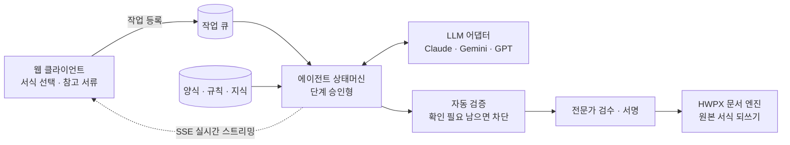

# PlanDoc · Administrative Document AI Agent

> An AI agent that fills Korean administrative and statutory forms by each company's rules, and exports a submission-ready HWPX file. Started as a grant-proposal writer, pivoted to administrative documents, now in paid production.
>
> 회사마다 다른 규칙대로 행정문서·법정서식을 채우고, 제출용 한글(HWPX) 파일까지 만드는 AI Agent. 사업계획서 자동화로 시작해 행정문서 자동화로 피보팅했고, 유료로 운영 중.

**Period** 2024 ~ · **Role** 기획 · 설계 · 개발 · 운영 (1인) · **Code** private (이 레포는 구조와 의사결정만)

화면은 시연용 문서입니다.

---

## 1. 성과

| 지표 | 값 |
|---|---|
| 월 LLM API 호출 | **30,000+** |
| 운영 | 유료 운영 중 |
| 대표 도입 사례 | 소방 점검업체 법정서식(별지 제9호서식) 자동작성 |
| 사업화 연계 | '24 창업중심대학 예비부문 최우수 · '25 청년창업사관학교 15기 |

## 2. 피보팅: 사업계획서 → 행정문서

| | v1 · v2 (2024 ~ 2026.07) | v3 (2026.08 ~) |
|---|---|---|
| 문서 | 정부지원 사업계획서 6종 | 행정문서 전반 · 법정서식 |
| 핵심 개념 | 지원사업(program) 고정 | **서식(template)이 1급 개념**. 서식이 단계를 정의 |
| 품질 근거 | 공고 구조화 | **참고(합격·완성) 서류 few-shot** + 회사별 규칙 |
| 고객 | 예비 창업자 | 매일 서류를 쓰는 SMB · 전문가(행정사 · 세무 · 시설관리) |

바꾼 이유: 사업계획서는 1년에 몇 번 쓰는 문서다. 행정문서는 매주 쓴다. 쓰는 빈도가 곧 과금 근거다.

## 3. 아키텍처

| 결정 | 이유 |
|---|---|
| 자유 대화형 대신 **상태머신** | 단계마다 승인을 받아야 환각이 다음 단계로 번지지 않는다 |
| **양식 · 규칙 · 지식 3층** | 원청마다 서식 · 체크 조건 · 근거 조문이 다르다. 이를 업종 무관 구조로 담아 AI가 "그럴듯하게"가 아니라 **규칙대로** 채운다 |
| **확인 필요 → 서명 불가 → 내보내기 불가** | 법정서식은 틀리면 책임이 생긴다. 검증을 통과 못 하면 파일이 안 나가게 막았다 |
| **LLM 어댑터** | 공급자 교체와 단계별 모델 분리, 프롬프트 캐시로 비용 관리 |
| **자체 HWPX 엔진** | HWPX 서술형 명세는 공개돼 있지 않다(규범은 유료 KS X 6101). 원본 양식을 그대로 되쓰고, 표 · 셀 · 문단 · zip 구성 11종을 검사해 맥 · 윈도우 한글에서 모두 열리는지 확인한다 |

**Stack** Next.js · Supabase(RLS · 토큰 원장 RPC) · Vercel · SSE · TypeScript HWPX 엔진

## 4. 다음

양식 · 규칙 · 지식 층을 PlanDoc 밖으로 꺼내 회사 전체의 업무 지도(온톨로지)로 키우는 것이 [galrae](https://github.com/TreeJin99)다.

---

Woojin Nam · <a href="https://github.com/TreeJin99">@TreeJin99</a> · <a href="https://jigeum.info">jigeum.info</a>
